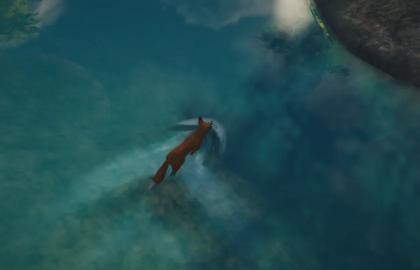

# Tarn performance audit · 27 November 2026

The high-resolution swim was the main target. The fox now pushes the same bow wave and leaves the same four paw trails and tail wake with **82% less water texture traffic** in the sustained-swim fixture. In the uncapped game at 2560 × 1600, median GPU time for the whole swim frame fell from **17.27 to 16.55 ms**. The slow end still reached **17.76 ms**. A 60 Hz display gives us 16.67 ms per frame. The most expensive view we measured was looking across the wooded shore.

The published package fell from **11.32 to 8.04 MB**. The actual cold download for the three-view route fell from **3.02 to 2.88 MB**. Tarn still places 1,233 trees and 5.55 million grass roots across the world. [Play Tarn](https://beerooyay.github.io/boxel/) · [Code changes](https://github.com/beerooyay/boxel/compare/9f40e5f..61e40db)



## What a frame cost

We compared the previous public build, `9f40e5f`, with the optimized build, `61e40db`, on an Apple M4 Max with 36 GiB, macOS 26.5.2 and Chrome 158.0.8127.88 using WebGL2 through ANGLE Metal. Both ran the normal play entry with HDR and 4× MSAA at the stated drawing-buffer size. The route held forward, accelerated and turned in deep water, then sampled the wooded shore and waterfall viewpoints. The benchmark checked that the animal stayed in the swimming state and moved over five metres.

The table gives whole-frame GPU milliseconds with browser frame limiting disabled. Each entry averages two run-level medians or 95th percentiles. Each run had 48 warm-up frames and 180 measured frames per view, with GPU queries every fifth frame. The replay advances the game clock at a fixed 60 Hz so both versions see the same inputs. CPU submission can overlap earlier GPU work, so callback intervals and GPU times measure different things. [All 48 run/view results](tarn-frame-times.csv) · [Replay code](../bench/performance.cjs)

| Drawing buffer | View | Median before | Median after | p95 before | p95 after |
|---|---|---:|---:|---:|---:|
| 1280 × 768 | Swimming turn | 3.80 | 3.57 | 5.55 | 5.46 |
| 1280 × 768 | Wooded shore | 12.62 | 12.66 | 14.23 | 13.74 |
| 1280 × 768 | Waterfall | 10.63 | 10.74 | 11.76 | 11.80 |
| 2560 × 1600 | Swimming turn | 17.27 | 16.55 | 18.43 | 17.76 |
| 2560 × 1600 | Wooded shore | 27.63 | 27.44 | 28.71 | 28.30 |
| 2560 × 1600 | Waterfall | 24.83 | 24.27 | 25.92 | 25.59 |

At high resolution the swim’s p95 CPU submission time fell from 9.85 to 7.60 ms. The open-water turn benefited more than either land view. In the uncapped runs, callbacks over 25 ms still occurred on the high-resolution shore (44 → 46 across 360 frames) and at the falls (28 → 30).

With ordinary browser pacing, p95 callback intervals were 16.7–16.8 ms across both revisions, with zero intervals above 25 ms. GPU timings in these paced runs were mixed. At 1280 × 768, shore median rose from 11.56 to 14.04 ms and waterfall median from 10.63 to 12.68 ms. At 2560 × 1600, swim median rose from 12.47 to 13.05 ms while p95 edged down from 16.38 to 16.23 ms. These short headless comparisons covered one desktop GPU.

We then let the public build run on its own clock for a **75-second swim at 2560 × 1600** on the same Mac. The fox travelled 133.2 m, reaching 18 waypoint turns using native forward, steering and sprint input. All 4,501 recorded intervals were moving and swimming. Browser callback intervals were 16.7 ms at the median and p95, and 16.8 ms at p99 and maximum. None crossed 25 ms. HDR, 4× MSAA, full grass density and full drawing resolution held throughout. The reported hitch did not recur in this session. Browser callback timestamps measure scheduling. Physical display presentation, longer sessions, Safari GPU time and phone GPU time remain unmeasured.

### Where the GPU spends its time

A separate 1280 × 768 diagnostic put timers around individual groups over 330 frames per view. These medians identify expensive groups. On this tile-based GPU, inserting a timer between passes can force attachment loads and stores. Adding the columns would overstate frame cost.

| View | Trees and plants | Grass | Terrain and rocks | Water surface | Planar reflection | Resolve and post |
|---|---:|---:|---:|---:|---:|---:|
| Wooded shore | 6.48 ms | 5.00 ms | 5.11 ms | 4.37 ms | 3.15 ms | 4.81 ms |
| Waterfall | 5.38 ms | 4.84 ms | 4.41 ms | 3.52 ms | 2.94 ms | 3.86 ms |
| Open-water swim | 2.64 ms | 1.86 ms | 2.32 ms | 3.04 ms | 1.07 ms | 3.32 ms |

Trees and understory led at the wooded shore. Open water shifted the cost toward shading the surface and resolving the final image. The quarter-resolution mist and shaft passes, bloom, temporal resolve and multisampling are all part of the rendering budget. The ordinary cloud update had a median of zero in all three views and averaged 0.17–0.40 ms. These measurements put vegetation coverage and high-resolution screen passes ahead of more field-solver tuning as targets for future profiling.

## Water, animal contact and grass

The animal, the water simulation and the renderer used to repeat three kinds of work. The contact skin repeatedly posed coincident vertices, the upload spanned quiet water between disturbances, and every visible water patch used the wake shader. That shader already exited early on pixels outside the swimmer’s bounds. We kept the visible shape of the bow and the articulated paw and tail contacts.

| Sustained 30 Hz swim fixture | Before | After |
|---|---:|---:|
| Contact, simulation and packing, median / p95 | 1.035 / 1.280 ms | 0.799 / 0.970 ms |
| Wave integration, median / p95 | 0.584 / 0.734 ms | 0.537 / 0.659 ms |
| Texture packing, median / p95 | 0.456 / 0.550 ms | 0.263 / 0.319 ms |
| Average texture payload per tick | 177,243 B | 31,191 B |
| Average texture upload calls per tick | 13.75 | 8.45 |

The fixture runs a turning hull, five smaller contacts and periodic independent impacts for 1,500 ticks, discarding the first 301. The CPU timings end when the GL stub receives the uploads. GPU and driver costs appear in the frame measurements above. [Water benchmark](../bench/water-surface.mjs)

- **Water uploads.** Two alternating RGBA8 layers carry consecutive 30 Hz states. The renderer interpolates them between ticks. The packer uploads contiguous runs of 16 × 16 tiles whose encoded texels changed. It clears disturbances that have died away, including after skipped frames and resets. Over 2.6 million interpolated channel comparisons, the largest difference from the old representation was about 5.6 × 10⁻¹⁷ in byte units. [Water implementation](../demo/water-surface.js) · [Regression tests](../tests/water-surface.mjs)
- **Wake shading.** Only visible surface patches overlapping the wake bounds run the full bow, paw and tail calculation. Other patches retain the river, wind, reflection, refraction and propagated wave detail. The draw keeps its original depth order around banks and boulders. We discarded an earlier shader variant after it slowed the high-resolution swim. [Wake geometry and shader](../demo/swim-wake.js) · [Water draw](../demo/game.js)
- **Animal contact.** The grass and water share a CPU skin made from vertices with identical positions, joint influences and weights. Across twelve rigs the CPU poses 15,196 vertices instead of 50,967. The fox fell from 3,752 to 1,071. In isolated animation and water-contact measurements the fox median fell from 0.070 to 0.031 ms, the cow from 0.087 to 0.036 ms. Across 144 poses, all 301,428 posed triangle comparisons and waterline extents matched. The GPU still draws the authored animal mesh. [Contact skin](../demo/animal-rig.js)
- **Grass.** Contact reuses its spatial bins and avoids retrying empty patches of deep water. In the public grass lab the stationary fox directly displaced 44 blades and coupled another 25. Turning neighbour coupling off yielded 46 direct and zero coupled blades. Both counts reached zero at jump apex, then returned on landing. [Contact benchmark](../bench/fox-grass.cjs)

## Clouds, terrain and render detail

| Full desktop cloud bake, GPU median | Before | After | Faster pairs |
|---|---:|---:|---:|
| Clear | 2.990 ms | 2.934 ms | 11 of 22 |
| Light rain | 4.697 ms | 4.618 ms | 14 of 22 |
| Full storm | 6.898 ms | 6.649 ms | 17 of 22 |

Each weather state had two discarded warm-up pairs and 22 measured pairs with alternating order. We compared readbacks for every pair against the previous shader and checked each state against a marcher with empty-space skipping disabled. **All 2,359,296 RGBA bytes per atlas matched** in clear weather, light rain and full storm. The storm path skips an unnecessary density-bound lookup. The clear-sky difference was within run variation. These fixed-view bakes establish image parity in the tested weather states. Long moving storms on mobile remain an open measurement. [Cloud renderer](../demo/clouds.js)

Clouds now reuse the weather upload and its mipmaps across bakes until the weather field changes. Billow noise dropped a redundant channel, taking the initial upload from 1,048,576 to 786,432 bytes. The weather texture allocates five mip levels for the range actually sampled. The driver can pad internal storage. Normal play builds a new atlas over 26 frames, roughly once per second, with earlier updates for movement or changing rain. Two complete layers crossfade while the third builds. Startup and a rewind can still require a full bake.

The canopy shelter map took **4.2 → 1.7 ms** to generate at startup across 16 paired evaluations. All 131,072 output bytes matched. After uploading the near terrain mesh, the CPU now retains the height grid used by animals and terrain sampling. Releasing obsolete terrain staging arrays removes **17.48 MiB** of retained backing buffers by construction. One paired Chrome reading after entering play and collecting garbage showed **39,910,038 → 21,203,374 bytes** of total backing storage. Runtime heap numbers vary with the GC and exact frame. [Shelter bake](../demo/atmosphere.js) · [Terrain lifetime](../demo/game.js)

| Shipping renderer | Configuration |
|---|---|
| Valley population on the desktop route | 256 × 256 m playable valley, 1,233 procedural trees including the skyline, 269,919 leaf sprays and shoots, 41,682 understory instances and 5,554,344 grass roots. View and distance select the instances drawn. |
| Main scene | WebGL2, HDR RGBA16F when available, RGBA8 fallback, up to 4× geometry MSAA with compatible 24-bit depth. Two RGBA8 history targets for the eight-phase temporal resolve. |
| Shadows and atmospheric effects | Three 2560² desktop or 1536² touch depth16 shadow layers, constrained by device limits. Mist and light shafts run at one quarter of each output dimension. Bloom runs at half and quarter dimensions. |
| Water | 432 × 736-cell domain at 0.24 m spacing, fixed 30 Hz wave updates. Half-width, half-height planar reflection with a scissor around projected water. Bow and limb detail stays local to the swimmer. |
| Clouds | Three RGBA8 atlas layers, 1536 × 384 with 168 march samples on desktop, 1024 × 256 with 120 on touch. Nominal atlas storage is 6.75 MiB and 3 MiB respectively. |

The graphics work here preserved the details the player called out. We inspected the continuous bow while accelerating, its change of direction during the turn, the dispersing trail after release and the waterfall view. We also checked the 1,572,864-texel sky cube against its reference. Every texel matched. [Tree and flora census](flora-audit.md) · [Picture regression](../bench/picture.cjs)

## Where Boxel earns its space

A disturbance has several consequences in Tarn. Paw contact can bend grass, displace water and excite glow. Boxel evolves glow at 60 Hz and moisture and wear at 15 Hz. Its gust field supplies travelling wind to foliage, wildlife and water. The upload path now skips blocks whose values still round to black, even when a neighbouring block in the same strip is lit. A 1,200-tick replay matched every uploaded byte and cleared retired blocks. The water solver carries signed height and velocity with currents and reflects waves at solid boundaries. Keeping these roles distinct lets the same animal pose and world coordinates drive each response, while each effect updates at the rate it needs.

The 900-tick night-river fixture ran the dense and sparse engines **in the same optimized build**. It compared three 2048² fields, then rendered the same 720 × 480 exposure in each mode. The timer includes scripted events, water and field stepping. Texture upload and rendering occur after the timer. [Fixture](../demo/verify.js) · [Field error guarantee](certificate.md)

| Night-river result | Dense reference | Boxel |
|---|---:|---:|
| Field cell updates | 5,662,310,400 | 38,771,968 |
| Reported field storage at the end | 96 MiB | 1.42 MiB |
| Scripted simulation time in this run | 1,486.1 ms | 331.5 ms |
| Largest absolute difference across 12,582,912 field values | Reference | 0.000902 or less |
| Largest rendered RGB difference | Reference | 0 of 255 |

Boxel stepped **0.68% as many cells** as the dense reference on this route. No retiring block exceeded its budget. The largest bound, 0.003629, stayed below the 1/255 target. Switching off glow changed the control picture by up to 74 levels, confirming the comparison contained a visible field effect. The storage figure covers the reported field allocations. GPU textures, the rest of the game and browser memory sit outside it. Dense workloads can reverse the timing result. In the earlier native storm fixture the dense update took 0.036 ms and Boxel took 0.051 ms. [Workload crossover measurements](results.md)

## Shipping footprint and stale work

| Scope | Before | After | Reduction |
|---|---:|---:|---:|
| Complete Pages package | 11,319,736 B / 77 files | 8,043,123 B / 60 files | 28.95% |
| Cold three-view route, decoded subresources | 4,997,316 B / 49 requests | 4,577,059 B / 49 requests | 8.41% |
| Same 49 public-CDN response bodies, gzip accepted | 3,020,785 B | 2,875,390 B | 4.81% |
| All twelve runtime animal GLBs | 5,306,364 B | 4,773,580 B | 10.04% |
| Fox GLB | 590,112 B | 315,752 B | 46.49% |

The route loads the fox and five nearby resident species. Other animals load on demand. The CDN comparison uses the same resource set, checks the decoded responses against each staged build and excludes the navigation document, HTTP headers, and third-party requests. A different route or animal choice can change this total. The optimized route comprises 38 JS modules (207,045 B transferred), one WASM module (28,062 B), one leaf atlas (827,792 B), three surface JPGs (809,571 B) and six animal GLBs (1,002,920 B).

- **Archived oaks.** Seventeen deployment files, including the unused oak renderer, accounted for 2,749,488 B. We excluded them from Pages and removed dormant canopy and wildlife-obstacle branches. The trial, source links and credits remain in the repository. The old game already fetched zero oak files on this route, so the deployment saving had no effect on measured play traffic.
- **Animal data.** The importer now strips eight unreachable clips, removes ignored vertex colours and shares duplicate animation accessors. The twelve rebuilt files reproduce from the pinned originals. We compared 54,199 rendered vertices, 26,735 triangles, 59 active clips, 2,008 channels and 466,828 animation sample components. Retained draw attributes, joint data and animation samples matched. [Animal importer](../tools/import-animals.py)
- **Modules and textures.** The original 128 tracked files contained no byte-identical duplicates. All 39 JavaScript modules in the new site are reachable from the game, including the optional verification module. A local-binding scan found no unused bindings in the checked modules. The three leaf atlas variants serve different device capabilities and total 1,778,336 B in the package. A browser selects one. The release-built WASM file is 64,828 B before transport compression.
- **Resource lifetime and local processes.** Linked programs now release their temporary shader handles. The Rust and Bevy local build caches occupy about 132 MiB and 2.5 GiB on the development machine. Both live outside the public site. Two existing local preview servers served the checkout and showed zero CPU in the audit sample. Neither was part of the public render loop.

## Verification and replay

The optimized public root passed a walk from spawn into swimming, a 2.27 m paddle and a mouse-driven turn. All twelve animals rendered after selection through Field menu, and first/third person worked for every rig. Touch-emulated Chrome drew the smaller atlas, moved 4.65 m with a simultaneous joystick and camera gesture, and jumped. Both flows completed with zero failed resource requests, browser errors or WebGL errors. A second public smoke in macOS Playwright WebKit 27.2 rendered 47,165 grass instances in the sampled view and entered the jump animation through the touch control with zero page or GL errors. Touch emulation checks usability on the desktop GPU.

All 59 JavaScript tests and 20 default release Rust tests passed locally. CI also ran Rust with parallel stepping, native/WASM replay parity, the Bevy integration, lints and browser picture checks. All 60 files served by the public CDN matched the staged deployment byte for byte. [Verification run](https://github.com/beerooyay/boxel/actions/runs/46017089261) · [Pages deployment](https://github.com/beerooyay/boxel/actions/runs/46017089402)

To repeat the measurements, serve each checkout with its own local HTTP server and use the benchmark files from the optimized checkout. The browser benchmark requires Playwright with Chrome or Chromium installed. Repeat each drawing-buffer size and pacing mode twice per revision. The water fixture accepts the absolute path of either revision’s water module.

```sh
node bench/water-surface.mjs
node bench/water-surface.mjs /path/to/before/demo/water-surface.js
CHROME_CHANNEL=chrome node bench/performance.cjs http://127.0.0.1:8841/demo/ 1280 768
UNCAPPED=1 CHROME_CHANNEL=chrome node bench/performance.cjs http://127.0.0.1:8841/demo/ 2560 1600
CHROME_CHANNEL=chrome node bench/picture.cjs 'http://127.0.0.1:8841/demo/?test'
CHROME_CHANNEL=chrome node bench/fox-grass.cjs 'http://127.0.0.1:8841/demo/?grass-lab'
```
